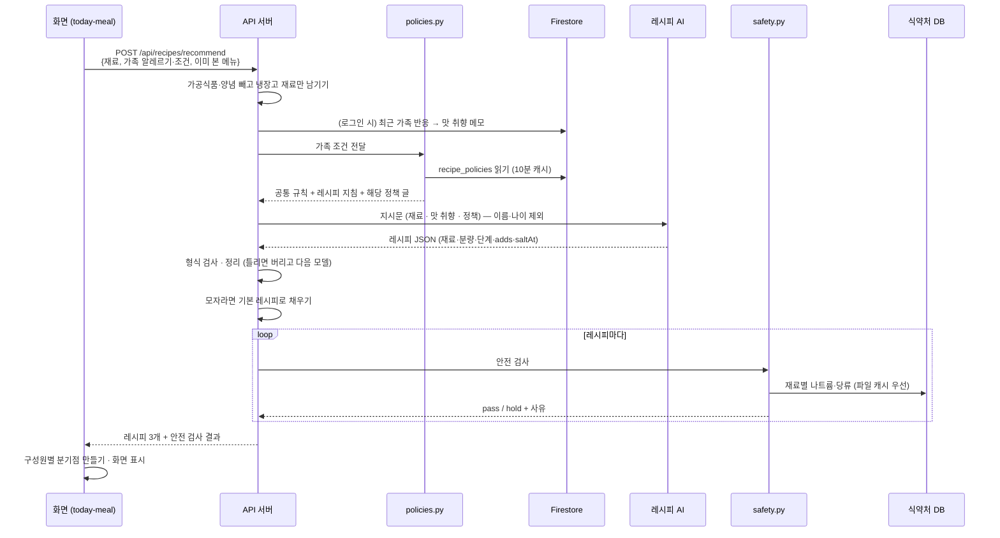

# 온가족 한상 — 시스템 아키텍처

- 기준: GitHub `main` 브랜치 (2026-10-27)
- 배포: 화면 https://m3-1-final-team-project.onrender.com · 서버 https://onfamily-hansang-api.onrender.com (`/docs`에서 API 문서)

---

## 1. 전체 구조

```text
┌──────────────────────────────── 사용자 (휴대폰·PC 브라우저) ────────────────────────────────┐
│                                                                                              │
│   화면 (정적 사이트, Final/)           HTML · CSS · JavaScript, 빌드 없음, 16개 화면           │
│   ├─ api.js        서버 연결 · 로그인 토큰 · 서버 장애 시 브라우저 저장소로 동작              │
│   ├─ nav.js        하단 탭 이동                                                              │
│   └─ localStorage  가족·재료·보관함 사본 (로그인 시 서버와 맞춤)                             │
└──────────────────────────────────────────────┬───────────────────────────────────────────────┘
                                               │ HTTPS · JSON · Bearer 토큰(JWT)
┌──────────────────────────────────────────────▼───────────────────────────────────────────────┐
│   API 서버 (Python · FastAPI, backend/)                                     Render Web Service │
│                                                                                              │
│   main.py ─┬─ auth.py      회원 인증 (PBKDF2 해시 · JWT 30일)                                 │
│            ├─ recipes.py   AI 레시피 추천 · 기본 레시피 10개                                  │
│            ├─ policies.py  레시피 추천 정책 22종 → AI 지시문                                  │
│            ├─ safety.py    안전 검사 (알레르기 · 당뇨식 · 저염식 · 유동식)                    │
│            ├─ vision.py    냉장고·영수증 사진 → 재료 이름 (사진 저장 X)                       │
│            ├─ images.py    AI 요리 사진 생성                                                  │
│            └─ fstore.py    Firestore 저장소                                                   │
└───────┬──────────────────┬────────────────────┬────────────────────┬──────────────────────────┘
        │                  │                    │                    │
┌───────▼───────┐  ┌───────▼────────┐  ┌────────▼─────────┐  ┌───────▼──────────────────┐
│ Firebase      │  │ 레시피 AI       │  │ 사진 인식 AI      │  │ 식약처                    │
│ Firestore     │  │ (OpenAI 호환    │  │ Gemini Vision     │  │ 식품영양성분 DB           │
│ 회원·가족·공유 │  │  API · Gemini)  │  │ 이미지 생성 API    │  │ (공공데이터포털)           │
│ 정책 22종      │  │                 │  │                  │  │ 나트륨·당류 100g당         │
└───────────────┘  └────────────────┘  └──────────────────┘  └──────────────────────────┘
```

**설계 원칙**
1. **AI는 제안만, 판정은 규칙 엔진이** — AI가 만든 레시피를 `safety.py`가 공공 데이터로 다시 검사합니다.
2. **필요한 정책만 AI에** — 가족 조건에 해당하는 정책만 골라 넣어 결과를 일정하게 만들고 비용을 줄입니다.
3. **개인정보 최소화** — 사진은 저장하지 않고, AI에는 가족 이름·나이를 보내지 않습니다.
4. **어느 하나가 실패해도 화면은 동작** — AI 실패 시 기본 레시피, Firestore 실패 시 내장 정책 파일, 서버 실패 시 브라우저 저장소를 씁니다.

---

## 2. 화면 (프론트엔드)

| 영역 | 파일 | 하는 일 | 쓰는 API |
|---|---|---|---|
| 시작 | `index.html` | 처음이면 회원가입, 로그인 기록이 있으면 홈으로 이동 | — |
| 회원 | `signup.html`, `login.html`, `my-info.html` | 가입(개인정보·건강 정보 동의), 로그인, 내 정보·탈퇴 | `/api/auth/*`, `/api/me` |
| 가족 | `family-profile.html` | 구성원별 캐릭터·알레르기·식사 조건 | `/api/me/data/family` |
| 재료 | `home.html`, `ingredient-check.html` | 냉장고·영수증 사진, 직접 입력, 피해야 할 재료 빨간색 표시 | `/api/ingredients/analyze`, `/api/me/data/pantry` |
| 추천 | `today-meal.html` | 레시피 3개 + 구성원별 분기점 + 안전 검사 결과 | `/api/recipes/recommend`, `/api/recipes/image` |
| 리뷰 | `feedback.html` | 가족별 반응 · 의견, 보관함 저장 | `/api/feedback`, `/api/me/data/saved` |
| 기록·공유 | `meal-record.html` | 식사 사진, 태그, 가족 의견 링크(카카오톡), QR(인스타그램) | `/api/posts`, `/api/shares`, `/api/records` |
| 가족 의견 | `family-feedback.html`, `family-reactions.html` | 받은 사람이 가입 없이 의견 남기기 / 보낸 사람이 반응 확인 | `/api/shares/{token}/*` |
| 커뮤니티 | `browse.html`, `dish.html` | 다른 집 한상, 공유한 요리 페이지(QR로 열림) | `/api/posts/*` |
| 보관 | `saved-recipes.html`, `recipe-book.html` | 저장한 요리·묶음, 나만의 레시피북 | `/api/me/data/{saved,collections}`, `/api/records` |

**공통 스크립트 `api.js`**
- 서버 주소 자동 선택: 배포 화면이면 Render 서버, `localhost`나 파일로 열면 `http://localhost:8000`을 씁니다.
- 로그인 토큰을 `localStorage`에 보관하고, 만료(401)되면 로그아웃 상태로 바꿉니다.
- 무료 서버가 깨어나는 시간(최대 약 50초)을 고려해 요청 대기 시간을 70초로 잡았습니다.
- 서버에 닿지 못하면 각 화면은 브라우저 저장소(`familyMembers`, `fridgeIngredients`, `savedRecipes` 등)로 계속 동작합니다.

**화면에서 계산하는 것**
- 구성원별 **분기점**(`today-meal.html`의 `buildBranches`)은 서버가 준 레시피의 `adds`(단계별 들어가는 재료)와 `saltAt`(간 하는 단계)을 보고 화면에서 만듭니다.

---

## 3. API 서버 (백엔드)

### 3-1. 모듈

| 파일 | 역할 |
|---|---|
| `main.py` | API 주소, 요청 검사(Pydantic), CORS, 시작 시 예시 게시물 넣기 |
| `auth.py` | 비밀번호 PBKDF2 해시, JWT 발급·확인(30일), 로그인 필수/선택 구분 |
| `recipes.py` | AI 레시피 지시문, AI 응답 정리(형식이 틀리면 버림), 모델 실패 시 다음 모델, 기본 레시피 순위 |
| `policies.py` | 가족 알레르기·식사 조건 → 정책 코드 선택 → AI 지시문에 덧붙일 글 (Firestore 10분 캐시) |
| `safety.py` | 알레르기 성분 대조, 1인분 나트륨·당류 계산, 판정 |
| `vision.py` | 사진 → 재료 이름 (영수증은 신선식품만, 가격·카드번호는 읽지 않음) |
| `images.py` | AI 요리 사진 생성, 같은 요리 이름은 다시 그리지 않음, 시간당 생성 한도 |
| `fstore.py` | Firestore 읽기·쓰기 |
| `upload_policies.py` | 정책 문서(md) → `data/recipe_policies.json` + Firestore 업로드 (관리자용) |
| `db.py`, `migrate_to_firestore.py`, `legacy/` | 예전 Postgres 저장소와 옮기기 도구, 예전 PubMed RAG 코드 (현재 미사용) |

### 3-2. API 목록

| 분류 | 주소 | 로그인 |
|---|---|---|
| 상태 | `GET /api/health` (DB·AI·식약처 연결 상태) | — |
| 회원 | `POST /api/auth/signup`, `POST /api/auth/login`, `GET /api/me`, `DELETE /api/me` | 일부 |
| 회원별 데이터 | `GET/PUT /api/me/data/{family·pantry·saved·collections}` | 필수 |
| 재료 인식 | `POST /api/ingredients/analyze` | — |
| 레시피 추천 | `POST /api/recipes/recommend` | 선택 (로그인 시 가족 반응 반영) |
| 안전 검사 | `POST /api/safety/check` | — |
| AI 요리 사진 | `POST /api/recipes/image`, `GET /api/recipe-images/{id}` | — |
| 식사 후 의견 | `POST /api/feedback` | 선택 |
| 다른 집 한상 | `GET/POST /api/posts`, `GET /api/posts/{id}`, `GET …/photo`, `POST …/like`, `POST …/report`, `DELETE /api/posts/{id}` | 일부 |
| 가족 의견 링크 | `POST /api/shares`, `GET/PUT /api/shares/{token}`, `POST …/responses`, `GET …/reactions`, `PUT/DELETE …/responses/{n}`, `GET /api/me/shares` | 일부 (받는 사람은 불필요) |
| 나만의 레시피북 | `GET/POST /api/records`, `GET /api/records/photo/{key}`, `DELETE /api/records/{id}` | 필수 |

---

## 4. 핵심 흐름: 레시피 추천



**실패에 대비한 동작**

| 실패 | 대신 하는 일 |
|---|---|
| 첫 AI 모델이 실패하거나 형식이 틀림 | 다음 모델로 한 번 더 시도 |
| AI 전부 실패 / 키 없음 | 기본 레시피 10개 중 재료가 많이 겹치는 순으로 |
| Firestore에서 정책을 못 읽음 | 서버에 내장한 `data/recipe_policies.json` |
| 정책 자체를 못 만듦 | 정책 없이 기존 지시문만으로 추천 |
| 식약처 API 느림·실패 | 미리 받아 둔 `data/mfds_nutrition.json` → 기본 수치 → 그래도 없으면 "확인 필요" |

---

## 5. 레시피 추천 정책 (22종)

```text
docs/레시피_추천_정책_22종.md  ──(upload_policies.py)──►  Firestore recipe_policies (문서 24개)
docs/recipe_guideline.md                              └─►  backend/data/recipe_policies.json (예비)
```

| 가족 프로필 선택지 | 적용 정책 |
|---|---|
| (모든 레시피) | 공통 규칙 · 레시피 지침 · QT-01(4인분) |
| 달걀 / 우유 / 대두 / 밀 | AL-01 / AL-02 / AL-04 / AL-05 |
| 견과류 | AL-03(땅콩) + AL-09(호두·잣) — 넓은 분류는 보수적으로 모두 제외 |
| 갑각류 | AL-07(새우·게) |
| 직접 입력: 땅콩·메밀·고등어·조개류·오징어 등 | 해당 AL 정책 |
| 당뇨식 | DM-01 ~ DM-04 |
| 저염식 | NA-01 ~ NA-04 |
| 유동식 · 이유식 | LQ-01 ~ LQ-03은 준비 중(비활성) → 안전 검사에서 "확인 필요" |

---

## 6. 안전 검사 (규칙 엔진)

| 검사 | 방법 | 결과 |
|---|---|---|
| 알레르기 | 레시피 재료 ↔ 가족 알레르기를 재료-알레르기 연결표(`data/ing_allergen.json`)로 대조 | 포함 시 **확인 필요** + 화면에서 분기점 안내 |
| 저염식 | 재료별 100g당 나트륨 × 분량 합 ÷ 4인분 | 1인분 **770mg** 초과 시 확인 필요 `[임시값]` |
| 당뇨식 | 당류 계산은 기록만 | 기준값 확정 전이라 **항상 확인 필요** |
| 유동식 · 이유식 | — | 전문가 기준 확인 전이라 **항상 확인 필요** |
| 수치 없음 · 분량 없음 | — | 통과시키지 않고 **확인 필요** |

- 화면 문구: 통과 → "안전 검사 완료", 확인 필요 → "확인이 필요해요". 자세한 사유는 운영 기록용입니다.
- 레시피·재료·공유 화면에 고지문: *"식약처 등 공공 데이터 기준, 참고용이며 성분표를 꼭 확인하세요"*

---

## 7. 데이터 (Firebase Firestore)

| 컬렉션 | 내용 | 비고 |
|---|---|---|
| `users/{번호}` | 이메일, 이름, 비밀번호 해시, 동의 내역 | 비밀번호 원문은 저장하지 않음 |
| `user_emails/{이메일}` | 회원 번호 | 같은 이메일로 중복 가입 방지 |
| `user_docs/{번호}_{key}` | 가족 프로필 · 확인한 재료 · 보관함 · 묶음 (JSON 글자) | 문서당 300KB 제한 |
| `posts/{번호}` | 다른 집 한상 게시물 | 신고 3회면 숨김 |
| `post_likes`, `reports` | 좋아요, 신고 이력 | |
| `feedback` | 식사 후 의견 | |
| `shares/{링크}` | 가족 의견 링크 (메뉴·사진·가족 별칭) | **24시간 뒤 닫힘**, 건강 정보 없음 |
| `share_responses` | 링크로 받은 가족 한 명의 의견 | 몸 불편 신고는 보낸 사람만 확인 |
| `records/{번호}` | 나만의 레시피북 | |
| `recipe_images/{번호}` | AI 요리 사진 정보 | 같은 요리 이름은 재사용 |
| `photos/{key}` | 사진 파일 (1280px JPEG) | 문서당 1MB 제한 때문에 줄여서 저장 |
| `recipe_policies/{코드}` | 정책 22종 · 공통 규칙 · 레시피 지침 | 버전 포함 |
| `counters/{이름}` | 숫자 번호 발급 | |

> Firestore는 "목록 안의 목록"을 저장하지 못해서 레시피·회원 데이터는 JSON 글자로 저장합니다.

**저장하지 않는 것**
- 냉장고·영수증 **사진 원본**: 메모리에서 재료 이름만 뽑고 버립니다.
- 영수증의 **구매 장소·가격·카드번호**: 읽지 않습니다.
- AI에 보내는 **가족 이름·나이**: 보내지 않습니다.

---

## 8. 외부 서비스와 설정

| 서비스 | 용도 | 환경변수 | 없거나 실패하면 |
|---|---|---|---|
| Firebase Firestore | 모든 데이터 | `FIREBASE_CREDENTIALS` | 서버가 데이터를 저장하지 못함 |
| 레시피 AI (OpenAI 호환 API) | 레시피 생성 | `OPENAI_API_KEY`, `OPENAI_BASE_URL`, `OPENAI_MODEL`, `OPENAI_FALLBACK_MODELS` | 기본 레시피 |
| 사진 인식 AI (Gemini) | 재료 인식 | `VISION_API_KEY`, `VISION_BASE_URL`, `OPENAI_VISION_MODEL`, `VISION_FALLBACK_MODELS` | 예시 재료 |
| 이미지 생성 API | AI 요리 사진 | `IMAGE_API_KEY`, `IMAGE_API_URL`, `IMAGE_MODEL`, `IMAGE_MAX_PER_HOUR` | 예시 사진 |
| 식약처 식품영양성분 DB | 나트륨·당류 | `MFDS_API_KEY` | 내장 수치 → "확인 필요" |
| 로그인 토큰 | JWT 서명 | `JWT_SECRET` | (배포 시 필수) |
| 화면 주소 허용 | CORS | `CORS_ORIGINS` | 모두 허용(`*`) |

> 키는 모두 Render 환경변수에만 넣고, `.env`와 Firebase 키 파일은 GitHub에 올리지 않습니다(`.gitignore`).

---

## 9. 배포와 협업

```text
 각자 feature 브랜치 ──► Pull Request ──► 리뷰 ──► main (보호 브랜치)
                                                    │
                          ┌─────────────────────────┴────────────────────────┐
                          ▼                                                  ▼
          Render Static Site  M3-1-Final-Team-Project      Render Web Service  onfamily-hansang-api
          배포 폴더 Final/ · 빌드 없음                      폴더 backend/ · Python 3.12
                                                            pip install -r requirements.txt
                                                            uvicorn main:app
                                                            상태 확인 /api/health
```

- 무료 요금제: 한동안 요청이 없으면 서버가 잠들어, 처음 요청에 약 50초가 걸립니다.
- 코드가 바뀌었는데 서버 동작이 그대로라면 **Clear build cache & deploy**로 다시 배포합니다.

---

## 10. 확정 전 항목

| 항목 | 현재 | 필요한 것 |
|---|---|---|
| 저염 한 끼 나트륨 | 770mg (하루 2,300mg ÷ 3) | 전문가 확정 |
| 당뇨식 기준값 | 없음 → 항상 확인 필요 | 탄수화물·당류 기준 확정 |
| 유동식 3종 | 정책만 있고 비활성 | 정의·단계 확정, 가족 프로필에 종류·단계 입력 추가 |
| 알레르기 분류 | 견과류·갑각류를 넓게 받음 | 구체 항목으로 세분화 |
| 시판 양념·가공식품 | 원재료표 데이터 부족 | 제품 원재료 데이터 확보 |
